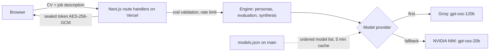

# CV Stress Test

[](https://github.com/GerardoLucero/cv-stress-test/actions/workflows/ci.yml)
[](LICENSE)


Simulate **N hiring managers** reading your CV. See what they think.

Paste your CV + a job description → N independent AI personas evaluate it in parallel → synthesized verdict with advance rate, suggested roles with fit score, strengths, concerns, CV adjustments, and course recommendations.

It also includes an **Interview Arena**: a live mock interview with an AI interviewer (voice or text, STAR scoring per answer) that ends in a scorecard with a hiring decision, radar scores and concrete CV fixes.

## Demo

**[cv-stress-test.vercel.app](https://cv-stress-test.vercel.app)**

## Deploy your own (free, 5 min)

[](https://vercel.com/new/clone?repository-url=https://github.com/GerardoLucero/cv-stress-test)

1. Fork this repo
2. Get a free API key at [console.groq.com](https://console.groq.com) (no credit card)
3. Deploy to Vercel — add the environment variables below
4. Share with your community

## Run locally

```bash
git clone https://github.com/GerardoLucero/cv-stress-test
cd cv-stress-test
npm install
cp .env.example .env.local   # add your GROQ_API_KEY
npm run dev
npm test      # unit tests (vitest)
```

### Environment variables

| Variable | Required | Purpose |
|---|---|---|
| `GROQ_API_KEY` | one of the two | Primary model provider |
| `NVIDIA_NIM_API_KEY` | one of the two | Fallback provider (NVIDIA NIM) |
| `NVIDIA_MODEL` | no | NIM model, default `openai/gpt-oss-20b` |
| `GROQ_MODEL` | no | Groq model, default `openai/gpt-oss-120b` |
| `MODEL_CONFIG_URL` | no | Override the URL of `models.json`, or `off` to use only the bundled copy |
| `MODEL_TIMEOUT_MS` | no | Per-call model timeout, default 25000 |
| `MODEL_BUDGET_MS` | no | Total model time per request, default 55000 |
| `SESSION_SECRET` | production | 32+ chars, seals interview sessions |

Generate the secret with `openssl rand -base64 48`.

## API

```bash
curl -X POST https://cv-stress-test.vercel.app/api/analyze \
  -H "Content-Type: application/json" \
  -d '{
    "cv": "Your CV text here",
    "jobDescription": "Job description here",
    "n": 5
  }'
```

### Interview Arena

`POST /api/interview/init` → `/answer` (once per question) → `/finalize`.
Sessions are stateless: each response carries a sealed `token` (AES-256-GCM, 2 h TTL) that the client sends back, so nothing is stored server side and it works across serverless instances. Request bodies are validated with zod, model output is parsed and clamped, and endpoints are rate limited per IP (best effort, per instance).

## How it works

1. Generates N industry-specific hiring manager personas matched to the role
2. Each manager evaluates your CV independently (concurrency pool, respects Groq limits)
3. Synthesizes all reactions into actionable feedback:
   - **Advance rate** — % of managers who would move you forward
   - **Suggested roles** with fit score — what you can apply to now
   - **CV adjustments** — section-by-section specific actions
   - **Course recommendations** — targeted courses to close skill gaps
   - **PDF report** — downloadable via browser print

## Architecture



- **Stateless sessions.** The interview state travels in a sealed token, so there is no database and any serverless instance can serve any request.
- **Provider cascade.** Groq first, NVIDIA NIM as fallback. Within a provider, models are tried in the order of `models.json`; a retired model (HTTP 404/410) falls through to the next one.
- **Bounded time.** One request budget (55 s by default) is shared across providers and retries, so a slow provider cannot hang the route.
- **Validated output.** Every model reply is parsed and checked against a zod schema; a bad reply is retried once on the other provider.

### Changing models without a deploy

Edit `models.json` on `main`:

```json
{ "groq": ["openai/gpt-oss-120b"], "nim": ["openai/gpt-oss-20b"] }
```

The app reads it from GitHub (5 minute cache) and falls back to the copy bundled in the build. `GROQ_MODEL` / `NVIDIA_MODEL` still work as an emergency override. A scheduled workflow (`Models check`) probes every listed model daily and sends a push notification if one stops answering.

## Quality

- 50 unit tests (Vitest), type check and production build on every PR.
- `GET /api/health` reports provider configuration and the active model list without calling any model, for uptime monitors.
- The stress test shares the interview's provider cascade, fences untrusted text, rate limits per IP and never returns provider error text to the client.
- Dependabot for npm and GitHub Actions, `npm audit` clean.
- Security policy in [SECURITY.md](SECURITY.md).

## Tech stack

- Next.js 15 · TypeScript
- Groq (`gpt-oss-120b`) with NVIDIA NIM fallback
- zod validation · Vitest
- Stateless — no database required
- Deployed on Vercel


## Support

Free and open source (MIT). If it helped your job search and you want to say thanks:

[](https://ko-fi.com/gerardolucero)
[](https://buymeacoffee.com/lucerorios0)
[](https://github.com/GerardoLucero/cv-stress-test/stargazers)


## License

MIT, see [LICENSE](LICENSE).
